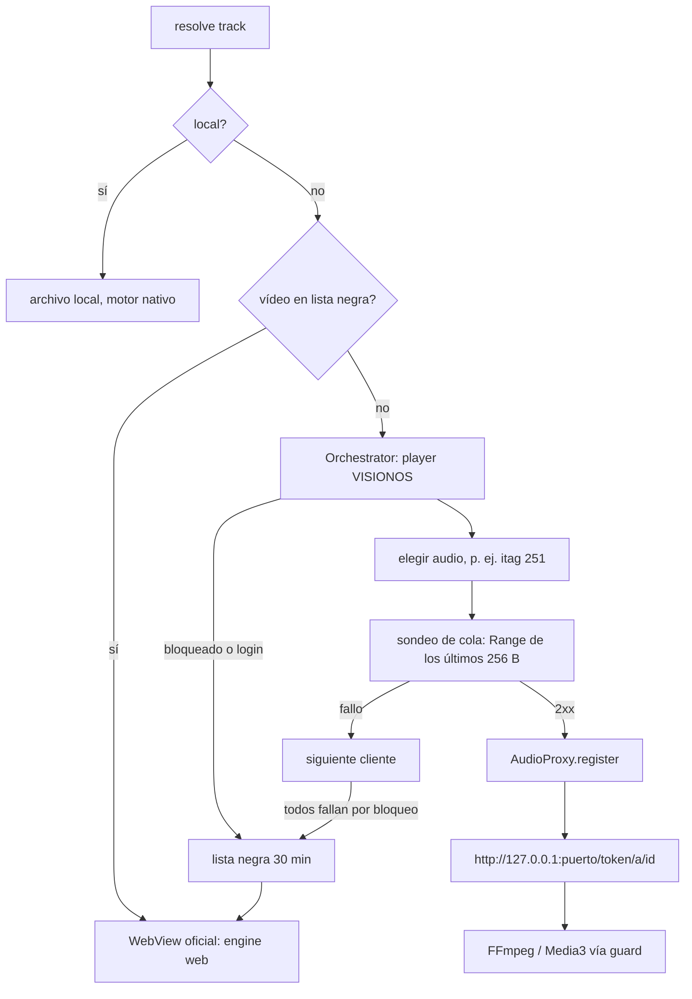

# Motor de audio de YouTube: InnerTube + proxy local, con respaldo web

Decisión del usuario (15/10/2026, revisada): la reproducción de YouTube usa el
endpoint `player` de InnerTube con el cliente **VISIONOS** (como LIMusic); los motores
nativos reproducen a través de un proxy de bucle local, y el reproductor oficial de
`music.youtube.com` en un WebView invisible queda como **respaldo automático**.
Antes (decisión del mismo día) todo iba por el WebView; se revisó porque el motor
nativo da ecualizador, espectro y segundo plano estable.

Sigue sin existir: tokens PO / BotGuard, descifrado de firma o `n`, saltarse
restricciones Premium, ni pasar una URL cruda de YouTube a FFmpeg/Media3.

## Piezas

| Pieza | Papel |
| --- | --- |
| [`InnerTubeSource`](../lib/sources/innertube_source.dart) | Búsqueda (canciones, álbumes, artistas, vídeos, continuación). `resolve()` crea de forma perezosa orquestador y proxy, y devuelve la URL del proxy (motor nativo) o la página `watch?v=<id>` (motor web). |
| [`StreamOrchestrator`](../lib/sources/stream/stream_orchestrator.dart) | `POST /youtubei/v1/player` sin clave de API; elige formato de audio, valida con sondeo de cola, caché LRU (50), lista negra de 30 min por vídeo y TTL de clientes malos. |
| [`player_clients.dart`](../lib/sources/stream/player_clients.dart) | Tabla escrita a mano de clientes (VISIONOS primario). Solo sirven formatos con `url` plana; los de `signatureCipher` se omiten. |
| [`AudioProxy`](../lib/sources/stream/audio_proxy.dart) | Servidor `127.0.0.1`: sirve el rango pedido en trozos de 4 MiB, renueva la URL si caduca o da 401/403/410 y reintenta el trozo. |
| [`ResolvedStream`](../lib/sources/stream/resolved_stream.dart) | Resultado: URL, cabecera `User-Agent`, `expiresAt`, cliente, itag, longitud. |
| [`stream_guard.dart`](../lib/audio/stream_guard.dart) | `assertNotRawYouTube`: error si FFmpeg/Media3 reciben youtube.com, googlevideo.com, ytimg.com, etc. Solo se admiten archivos locales y `http://127.0.0.1:<puerto>/...`. |
| [`RoutedMusicAudio`](../lib/audio/routed_music_audio.dart) | Un único motor activo, según `ResolvedAudio.engine` (`native` o `web`). Solo la finalización del motor activo avanza la cola. |
| [`WebMusicAudio`](../lib/audio_web/web_music_audio.dart) / [`NativeWebMusicBridge`](../lib/audio_web/web_music_bridge.dart) | Respaldo: `AudioBackend` sobre la página oficial (`flutter_inappwebview` 6.1.5, política de navegación, filtros de anuncios, `webMusicMediaScript`). |
| [`aurora_shell.dart`](../lib/ui/aurora_shell.dart) | Monta el WebView una sola vez (siempre inicializado, necesario para el respaldo automático). |

Locales: Android Media3 (`AndroidMusicAudio`) y Windows SoLoud + FFmpeg (`MusicAudio`).
Con el motor nativo (local o YouTube vía proxy) hay ecualizador y espectro; con el
respaldo web `supportsEqualizer` y `supportsVisualization` son falsos y la interfaz
lo indica. `ffmpegHttpsOptions` (`audio_math.dart`) añade `-rw_timeout` y `-reconnect*`
también al `http` de bucle local.

## Flujo

## Matriz de fallos

| Situación | Respuesta |
| --- | --- |
| 403/401/410 de googlevideo a mitad de reproducción, o URL a punto de caducar (margen 30 s) | El proxy renueva (`forceRefresh`, mismo itag, una sola renovación por vídeo) y reintenta el trozo una vez. |
| La renovación falla o cambia la longitud | Sin cabeceras enviadas: `410`. Con cabeceras enviadas: corta el socket. La app lo trata como recuperable y vuelve a resolver. Nunca 403/502 hacia el reproductor. |
| Flujo truncado (menos bytes que la longitud) | `validateCompletion` falla con «Premature EOF»; el controlador recupera la pista. |
| Bot/login (`blocked`, `accessDenied`, LOGIN_REQUIRED, «not a bot») en todos los clientes | Respaldo web automático y lista negra de 30 min para ese vídeo. El cliente que respondió así queda relegado 2 min. |
| Respuesta inesperada o sin formato reproducible (p. ej. todas las URLs cifradas) | Respaldo web automático para esa pista, sin lista negra. |
| Android (sin respaldo web) | El WebView oculto no carga en Android: en vez de usarlo, se reintenta una vez la resolución nativa y, si vuelve a fallar, se muestra el error real. |
| Transitorio (red, tiempo agotado, DNS) o no disponible (UNPLAYABLE, retirado) | Sin lista negra ni web: error normal con reintento. |
| Cliente con 403 o sondeo fallido | Se marca malo 10 min (2 min si es error de red); se prueba el último. |

## Qué se permite y qué sigue prohibido

- Permitido: `player` de InnerTube con el cliente VISIONOS y cabeceras propias del
  cliente; `visitorData` desde `sw.js_data`; formatos con `url` plana; proxy de bucle
  local (solo `127.0.0.1`, nunca `localhost`).
- Prohibido: tokens PO / BotGuard, descifrado de firma o `n`, saltarse restricciones
  de Premium, pasar URLs crudas de YouTube/googlevideo a FFmpeg o Media3, guardar
  secretos. yt-dlp, solo descargas explícitas e importación de listas.
- Android: `network_security_config.xml` permite texto claro únicamente a
  `127.0.0.1`; `AuroraPlaybackService` acepta `http` solo con host `127.0.0.1`,
  puerto y sin usuario.

## Respaldo web: nunca se ve la página

- El WebView está siempre montado (no `Offstage`: seguiría sin pintar) en una caja
  de 1×1 en la esquina, tapada por un cuadro opaco, con `IgnorePointer`,
  `ExcludeFocus` y `ExcludeSemantics`. CSS oculta además el `<video>`.
- No hay ningún botón que muestre el sitio durante el uso normal (se quitó la
  entrada «Acceso a YouTube Music» del menú).
- Solo si el sitio exige algo al usuario (página de consentimiento, inicio de
  sesión, verificación o un bloqueo de gesto) Aurora muestra un aviso en español
  con **Revisar sitio**. Ese botón agranda el mismo WebView como hoja sobre Aurora
  (sin reparentarlo); **Listo** la oculta y vuelve a intentar la canción.
- El inicio de sesión de Google dentro del WebView sigue bloqueado por la política
  de navegación existente: Google no admite ese acceso embebido.

## Órdenes y errores (antes «El sitio no pudo aplicar ese control»)

La causa del síntoma A era `play()` en carrera contra 4 s, colapsado en
`commandFailed`. Ahora el script de página:

- espera eventos reales `playing`/`timeupdate` con el elemento sin pausar, con un
  límite de 20 s (`playTimeout`); la llamada Dart tiene 5 s de margen extra;
- ante `AbortError` (el sitio cambió la fuente) vuelve a buscar el elemento,
  espera `loadeddata` y reintenta una vez;
- distingue `NotAllowedError` (`playBlocked`, pide revisar el sitio) y
  `TimeoutError` (`playTimeout`, basta con pulsar reproducir);
- solo busca posición con `readyState >= 1`; si no, la aplica en `loadedmetadata`;
- en los mensajes solo incluye nombres de error de una lista cerrada
  (`AbortError`, `NotSupportedError`, …), nunca mensajes, URLs ni DOM.

La espera inicial a que aparezca el elemento multimedia está acotada (30 s). Si el
sitio reproduce solo al navegar sin intención de Aurora, se pausa. No hay
reintentos automáticos de flujo: la recuperación del controlador ignora el motor web.

## Anuncios (sin garantías)

1. Filtros de red de `adblocker_webview` (EasyList/AdGuard) en la intercepción
   nativa, con dominios de YouTube/Google protegidos. **Solo Windows**: en Android
   la intercepción se desactiva por un ANR observado del plugin 1.1.3.
2. Si se muestra un anuncio (`.ad-showing`/`.ad-interrupting` en el reproductor),
   la página silencia su elemento multimedia, pulsa el botón «Omitir» del propio
   sitio en cuanto está visible y habilitado, y quita el silencio al terminar.
3. Aurora muestra «Anuncio · tu canción sigue después» en lugar del artista, no
   actualiza posición/duración con las del anuncio y nunca cuenta su final como fin
   de canción.

Los selectores de anuncios dependen del DOM del sitio y pueden cambiar.

## Metadatos y controles del sistema

Título, artista, álbum y portada salen del `Track` de Aurora (InnerTube); posición,
duración y fin, del elemento multimedia. Windows: `MediaControls` (SMTC) escucha el
`RoutedMusicAudio`, así que refleja la reproducción web y envía
reproducir/pausa/siguiente/anterior/buscar al controlador. Android: el servicio
Media3 recibe `external` dos veces por segundo y expone ese estado en su sesión
(`SessionPlayer.getState()`); sus órdenes vuelven como acciones (`seek:<ms>`
incluido).

## Android en segundo plano / pantalla apagada

Causa probable de las pausas anteriores: durante la reproducción web el servicio
Media3 no estaba reproduciendo, así que no pasaba a primer plano y Android podía
congelar o matar el proceso al salir de la app. Ahora:

- la sesión Media3 refleja la reproducción web → notificación y servicio en primer
  plano mientras suena;
- el servicio toma un `PARTIAL_WAKE_LOCK` (renovado, caduca solo a los 10 min sin
  noticias) y un bloqueo Wi-Fi mientras la web reproduce;
- `mediaPlaybackRequiresUserGesture: false`; el plugin no llama a
  `onPause`/`pauseTimers` por sí mismo y Aurora tampoco; la prioridad del renderer
  queda en la predeterminada (importante aun sin ser visible).

Pendiente y fuera de alcance legítimo: con un user agent móvil, el sitio puede
pausar la reproducción en segundo plano para cuentas sin Premium. Aurora no falsea
la visibilidad de la página ni el user agent para evitarlo.

## Windows

- Perfil WebView2 persistente en `<soporte>/youtube_music_webview`, reutilizado.
- Salida limpia: con el motor montado, cerrar la ventana pasa por
  `_confirmWindowClose`, que desmonta el WebView, espera un frame y libera el
  `WebViewEnvironment` antes de permitir el cierre (el entorno vivo retenía el
  proceso y `WebView2Loader.dll`).

## Pruebas y verificación

- Sonda real: `dart run tool/probe_innertube_clients.dart <videoId>`.
- Pruebas: `test/stream_orchestrator_test.dart`, `test/audio_proxy_test.dart`,
  `test/stream_guard_test.dart`, `test/routed_music_audio_test.dart`,
  `test/audio_math_test.dart`, `test/innertube_source_test.dart`,
  `test/stream_recovery_controller_test.dart`, `test/stream_engine_integration_test.dart`
  y, del respaldo web, `test/audio_only_engine_test.dart`, `test/web_music_script_test.dart`
  y `test/web_engine_shell_test.dart`.
- Verificado: la sonda en vivo resolvió ids reales con VISIONOS (itag 251, validez
  ~6 h, sondeo de cola 2xx) y FFmpeg real decodificó una canción completa y una
  búsqueda (seek) a través del proxy en Windows.
- **Requiere verificación en dispositivo (Android no verificado)**: canción normal;
  URL caducada (pausa > 6 h o forzarla con el depurador); cliente bloqueado (debe
  caer al WebView); segundo plano/pantalla apagada y notificación; anuncios del
  respaldo; SMTC y salida limpia en Windows.

Comportamiento inspirado en LIMusic/Metrolist (GPL-3.0); implementación propia, sin código copiado.
